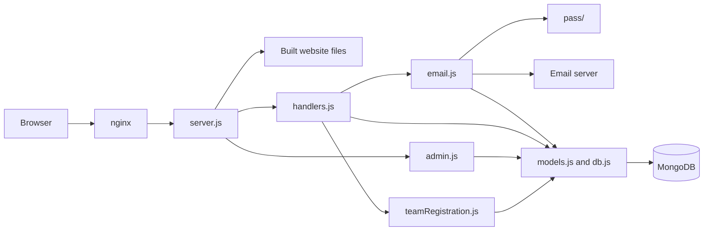
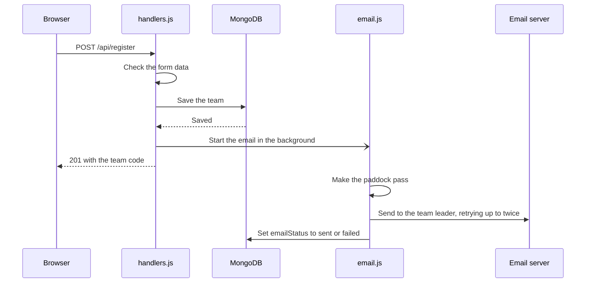

# Backend

The code behind the registration API. It checks each sign-up, saves it to MongoDB, and emails the team leader a paddock pass.

| File | What it does |
| --- | --- |
| `handlers.js` | Handles the API requests |
| `teamRegistration.js` | Checks the form data and creates the team |
| `models.js` | Defines what's stored in the database |
| `email.js` | Sends the confirmation emails |
| `pass/` | Makes the paddock pass image |
| `admin.js` | Handles the dashboard's login and data |
| `db.js` | Connects to MongoDB |
| `server.js` | Runs the API and, in Docker, serves the website |

The form rules, like what counts as a valid phone or roll number, are in `../shared/teamRules.js`. The website uses the same file.

## How it fits together

One Express server handles both the website and the API.



When a team registers, the API replies as soon as the team is saved. The email carries on in the background, so a failed email never undoes a registration.



## Run it locally

You'll need MongoDB running on your machine, or a free Atlas database. Then start the API:

```bash
npm ci
cp .env.example .env
npm run dev
```

It runs on http://localhost:4001. Settings go in the `.env` file, which never gets committed. The example points at a local MongoDB and sends no emails. Docker reads the same file.

The [root README](../../README.md#deploy-it) lists the other settings, including the ones for sending emails.

## Run the tests

The tests start their own temporary MongoDB, downloading it the first time, so they never touch real data or send real emails.

```bash
npm test
```

GitHub runs these, plus a website build and a Docker build, on every push to `main` and on every pull request. The same workflow also deploys the site, as the [root README](../../README.md#deploy-it) explains.

## API

The whole app lives under `/gitogether2026`, set in `../shared/basePath.js`, so `/api/register` below is really `/gitogether2026/api/register`. Don't change this prefix. The live site's nginx only sends `/gitogether2026` to this app, so any other prefix takes the site down. The prefix is also hard-coded in the `Dockerfile` health check.

| Method | Path | Login needed? | What it does | Success response |
| --- | --- | --- | --- | --- |
| `POST` | `/api/register` | No | Registers a team | `201` with the team's details |
| `GET` | `/api/status` | No | Says whether registration is open | `200` `{ "registrationOpen": true }` |
| `GET` | `/api/health` | No | Says whether the API can reach the database | `200` `{ "status": "connected" }` |
| `POST` | `/api/admin/login` | No | Logs in to the dashboard, given `{ "password": "..." }` | `200` `{ "ok": true }` |
| `GET` | `/api/admin/teams` | Yes | Lists every team, newest first | `200` `{ "teams": [...] }` |
| `GET` | `/api/admin/teams/:teamCode` | Yes | Finds one team, for the scanner | `200` `{ "team": {...} }` |
| `POST` | `/api/admin/teams/:teamCode/attendance` | Yes | Saves the marks that changed, given `{ "present": ["26N000"], "absent": ["26Z001"] }` | `200` `{ "team": {...} }` |
| `GET` | `/api/admin/attendance.csv` | Yes | Downloads attendance for everyone | `200` with a CSV file |
| `POST` | `/api/admin/logout` | No | Ends the session | `200` `{ "ok": true }` |

If the database is down, `/api/health` returns `500` with `{ "status": "database connection failed" }`.

### `POST /api/register`

```json
{
  "teamName": "Team Alpha",
  "members": [
    { "name": "Alex Morgan", "phone": "9876543210", "rollNumber": "26N000" },
    { "name": "Sam Lee", "phone": "9876543211", "rollNumber": "26Z001" }
  ]
}
```

| Field | Rules |
| --- | --- |
| `teamName` | Up to 60 characters. Doesn't have to be unique. Every team gets its own team code, like `GT-7KQ2MX`. |
| `members` | 2–3 members. The first one is the team leader, and only they get the confirmation email. |
| `members[].name` | Up to 100 characters. |
| `members[].phone` | A 10-digit Indian number. Spaces and a `+91` at the start are fine. |
| `members[].rollNumber` | Looks like `26N000` or `26Z000`, and can only be registered once. Batch 24 and older can't register. Each member's email is worked out from this, like `26n000@psgtech.ac.in`. |

If it works, you get back:

```json
{
  "teamId": "...",
  "teamCode": "GT-7KQ2MX",
  "teamName": "Team Alpha",
  "whatsappUrl": "...",
  "emailQueued": true
}
```

| Status | Meaning |
| --- | --- |
| `201` | Team registered |
| `400` | Something in the form isn't valid |
| `403` | Registration is closed |
| `409` | A roll number is already registered |
| `500` | Something went wrong on the server |

Errors come back as `{ "error": "A message you can show the user" }`. The exception is a request body that isn't valid JSON, which gets a `400` with Express's own HTML error page.

`emailQueued` is `false` when emails are turned off. When it's `true`, the email is on its way, but it may not have arrived yet. The API replies first and sends it in the background. A failed email is tried twice more, after 30 seconds and then 2 minutes. If those fail too, the team's `emailStatus` becomes `failed`.

### Admin dashboard

The page is at `/gitogether2026/admin`. Logging in with `ADMIN_PASSWORD` sets a cookie that lasts 30 days, and using the dashboard renews it. Changing the password logs everyone out. A wrong password, or a request to `/api/admin/teams` without a valid login, gets a `401`.

Years come from roll numbers, in `getStudentYear` in `../shared/teamRules.js`. Anything that doesn't fit is listed under "Check these".

### Attendance

Attendance is taken once, at entry, and each member is marked separately because a team shares one pass.

1. On the dashboard, tap **Scan pass** and point the camera at the QR on the team's pass.
2. Tick each member who's there and tap **Save**. Nothing changes until then. Closing with unsaved ticks asks first.
3. The camera is ready for the next team straight away. It ignores the last pass until that pass has left its view, and **Edit** on the "saved" message reopens the team for a quick fix.

For a late arrival, or a pass that won't scan, tap **Can't scan? Find team** in the scanner, or **Mark attendance** on the team's card on the dashboard. Both open the same screen. Saving someone who's already marked keeps the time they first arrived.

Each save is one database write that only touches the members who changed, so a save can't half-finish and two people marking the same team can't undo each other.

The QR only holds the team code. It does nothing without a dashboard login, so anyone else who scans it just sees the code.

The camera only works over HTTPS or on `localhost`, so opening a local dev server from a phone over `http://` will show the camera error.

## The paddock pass

Each team's pass is made when its email goes out, and it isn't stored. If a pass can't be made, the leader gets a plain email with the team's details and team code instead.

- To change the event date, edit `EVENT_DATE` in `../shared/teamRules.js`. The website's countdown, the pass and the email all use it.
- To change the layout, edit `pass/renderPass.js`.
- To change the email wording, edit `email.js`.
- To change the header, labels, or the website's logo, edit `pass/renderArt.js` and run `npm run pass-art`. That needs the F1 font installed, and you can point `F1_FONT_DIR` to it. The font itself stays out of the repo, and the results are saved as shapes in `pass/art/`.

The pass can show Latin and Tamil text. Anything else in a name, like emoji, is left off the pass.

## What gets saved

- **Teams:** team name, team code, whether the leader's email went out (`emailStatus` is `pending`, `sent`, or `failed`), when the team was created and last updated (`createdAt` and `updatedAt`), and its members. Each member has a name, phone, roll number, email, whether they're the leader, and when they were marked present (`checkedInAt`, empty until then).
