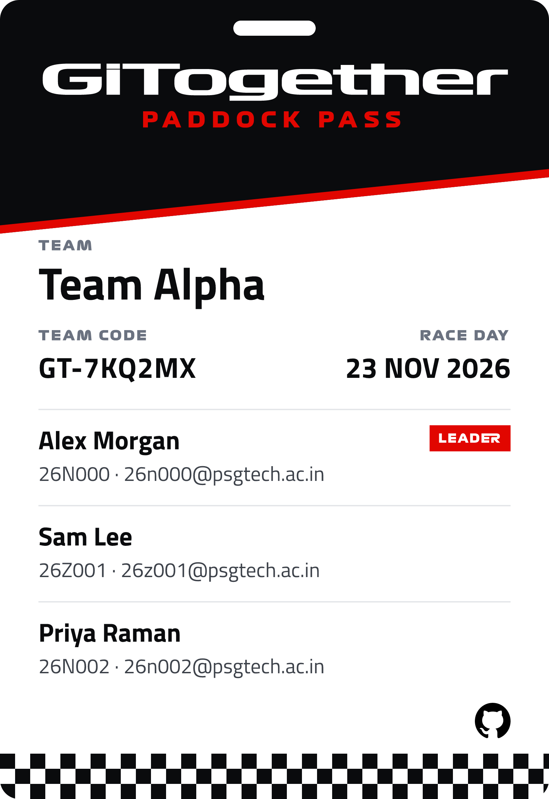

# Confirmation email preview

This is what the team leader receives. The team and people are made-up samples.

## The normal email

**From:** ghcc.club@psgtech.ac.in

**To:** 26n000@psgtech.ac.in

**Subject:** Welcome to the paddock, Team Alpha! 🏁

---

Welcome to the paddock, Alex Morgan!

Team Alpha is officially on the grid for GiTogether 2026, and we're so glad to have you with us.

Your team's paddock pass is attached :)

Before lights out, tune in to team radio. Join the WhatsApp group for all the updates, and bring your crew along:

**[ Join the WhatsApp group ]** (a green button with the WhatsApp logo that opens the group)

Lights out on 23 Nov. See you on the grid!

---

Email apps that only show plain text get the full link instead of the button.

**Attachment:** GiTogether-2026-Paddock-Pass.png, the same image, so it's easy to save.

## If the pass can't be made

This should be rare. The leader gets this plain email instead, so they still have the team's details.

**From:** ghcc.club@psgtech.ac.in

**To:** 26n000@psgtech.ac.in

**Subject:** Welcome to the paddock, Team Alpha! 🏁

---

Welcome to the paddock, Alex Morgan!

Team Alpha is officially on the grid for GiTogether 2026, and we're so glad to have you with us.

Team: Team Alpha

Members: Alex Morgan, Sam Lee, Priya Raman

Before lights out, tune in to team radio. Join the WhatsApp group for all the updates, and bring your crew along:
https://chat.whatsapp.com/H1ZTM3wvpVdCTJLqwfOfen?s=cl&p=a&mlu=4&ilr=4&iam=2

Lights out on 23 Nov. See you on the grid!

---

## On the success screen

Right after registering, the website shows:

> Team Alpha is registered with 3 members. We're emailing your pass to 26n000@psgtech.ac.in. See you on the grid!
